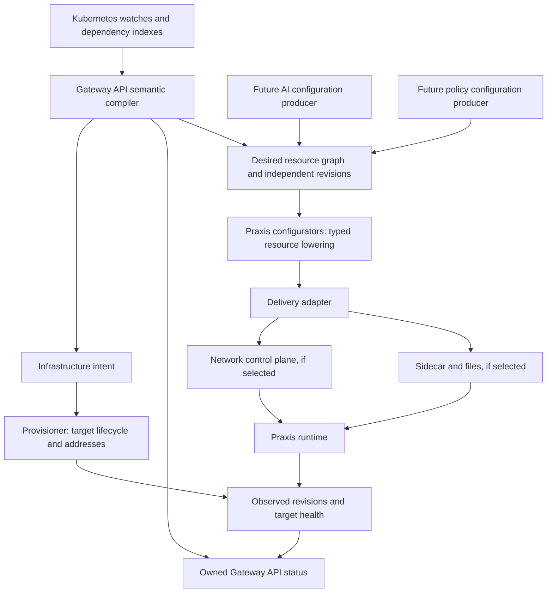

# Architecture and configuration contracts

Status: the resource, compiler, delivery and provisioner seams below have an HTTP mock-backed implementation plus an opt-in file-delivery adapter. The file adapter proves delivery only; it does not observe runtime application, so `Programmed` stays `False/Pending` with it. Remaining Route kinds, a real active-observation path and managed target lifecycle are future work. Scope and sequencing are in the [implementation plan](implementation-plan.md); source facts are in the [research notes](../research/praxis-configuration.md).

## 1. Modules and seams

Use concrete Go packages/functions for pure transformations. Introduce interfaces where behavior actually varies: the configurator/delivery seam, target provisioning, and observation of applied state. Inject these into reconcilers. Do not introduce an interface for every type or a general plugin framework.

Current package boundaries and reserved future packages:

| Location | Responsibility |
| --- | --- |
| `cmd/controller` | Flags, logging, scheme, manager, mock wiring and shutdown |
| `internal/controller` | GatewayClass/Gateway/HTTPRoute and backend watches, indexes, reconciliation and status ownership |
| `internal/gateway` | Pure HTTP attachment, validation, translation, precedence, backend and TLS Secret validation |
| `internal/config` | Typed intermediate resources, deterministic identity/revisions and change-set validation |
| `internal/delivery` | Configurator/provisioner interfaces, observations, receipts and resource diffs |
| `internal/delivery/mock` | Stateful simulated target, independent resource roots and sanitized operation journal |
| `internal/delivery/file` | Opt-in static-target adapter: owner-epoch fencing, atomic per-target YAML publication, delivery-only observation |
| `internal/praxis` | Pure lowering from typed resources to one Praxis YAML document; no I/O |
| `config` | Generated RBAC and hand-written manager deployment manifests |
| `internal/praxis` | Implemented pure YAML lowering; future network lowering stays behind the delivery seam |
| `internal/provisioning` | Reserved for a real target lifecycle implementation |
| `tests` | Reserved for real-Praxis and upstream conformance orchestration |

Start with upstream Gateway API types and upstream CRD bundles. Do not generate competing Gateway API CRDs. Add `api/` and controller-gen CRD generation only if a reviewed Praxis-specific resource becomes necessary. Avoid a public Go SDK, persistent intermediate-resource CRDs, an event bus or a database in the first implementation.

## 2. Resource identity, ownership and independence

An intermediate resource is a typed desired configuration record, not automatically a Kubernetes custom resource. Separate its semantic identity from its current content. Identity includes domain, kind, namespace/tenant scope, target scope and logical name. Carry source object UID and generation separately for attribution and replacement safety. Use UID-based ownership epochs to distinguish deletion/recreation under the same name.

| Resource family | Owns | References; independent updates |
| --- | --- | --- |
| Target/bootstrap intent | Listener socket inventory, protocol, TLS mode, process-level settings | Named listener and secret resources; startup-only changes go to the provisioner |
| Listener binding | Hostname/SNI selection, route-table references and certificate references | Route tables and secrets; no embedded endpoint lists |
| HTTP/GRPC route table | Normalized matches, ordered rules, actions and weighted backend references | Cluster IDs; ordering encoded explicitly, no dependence on Go map iteration |
| TLS/TCP/UDP route table | SNI or transport binding and weighted forwarding actions | Cluster IDs; TLS passthrough never owns a termination private key |
| Cluster | Stable backend identity, transport options and policy references | EndpointSet ID; backend configuration changes independently of membership |
| EndpointSet | Canonical address/port membership and relevant readiness data | Stable Service-port/protocol-derived cluster identity |
| Secret material | Authorized TLS certificate/key or other future credential material | Private delivery handle; never serialized into non-secret resources or status |
| AI configuration root | AI-owned typed configuration and referenced resource IDs | Future producer; changing it cannot rewrite generic routing or policy roots |
| Policy configuration root | Policy-owned document/configuration and referenced resource IDs | Future producer; changing it cannot rewrite AI or generic routing roots |

The exact names and serialization of AI and policy roots remain open. Preserve their independent ownership and revision domains now; do not invent CRDs, policy inheritance rules or arbitrary raw configuration injection to fill those placeholders. A root may have independently addressed children: specifically, a cluster's endpoint membership is a child resource with its own revision, even if a future file format nests it syntactically.

The Gateway controller publishes only Praxis resources. AI and policy remain independent producer-owned roots; the initial mock may seed opaque fixtures for those roots to prove they stay unchanged, but it does not add AI/policy APIs or reconcilers.

Default deployment assumption for planning: isolated targets per Gateway, with backend resources scoped to a target. One Service may feed several target-local endpoint sets; a change updates each relevant set without changing their clusters. Cross-Gateway resource sharing is an optimization to justify later. Never share secret/configuration resources across tenants merely because content hashes match.

Backend identity includes Service UID (or an equivalent UID-fenced incarnation), Service port and transport. Pod UID/address replacement changes only membership; Service deletion/recreation creates a new backend incarnation and retires the old one safely.

One producer owns a resource key. Reject conflicting ownership; do not use last-writer-wins merging of AI, policy and Gateway output. Each producer publishes a replacement of its own contribution, including deletions, rather than editing another producer's document. An explicit reference records dependencies between producers; adding a policy or AI producer must not make it a prerequisite for the generic controller to run.

## 3. Compiler contract

Inputs are immutable views of only the relevant Kubernetes objects, controller ownership configuration, and actual target capabilities. Outputs are desired resources, infrastructure intent, dependency references and structured diagnostics used to calculate status. The compiler performs no network I/O, filesystem writes or Kubernetes writes.

The compiler must preserve distinctions such as no backend reference, invalid backend reference, valid Service with zero ready endpoints, weight zero, unsupported optional field, and a denied cross-namespace reference. Do not collapse all of these into an absent cluster. Represent required HTTP/gRPC failures and transport refusal/drop behavior as explicit actions according to the pinned API rules.

Backend resolution and attachment are common modules across protocols. Route-kind translators own their matching and action semantics. When merging attached routes, normalize defaults and apply the exact upstream precedence and deterministic tie-breaks before Praxis lowering. Praxis's native router order is not the Gateway API contract; configurators must either faithfully encode the compiled order or reject lowering with a precise capability gap.

Kubernetes resourceVersions are opaque observation tokens, not numerical versions or values comparable across objects. Cache reads across kinds are eventually consistent, not a transaction. Record the dependencies used, maintain an internal observation epoch per key, and schedule recompilation when any dependency changes. An application result must identify the compiled revision it acknowledges. Do not publish a newer object's generation as observed by an older compilation.

## 4. Dependency tracking and invalidation

Register field indexes once before manager startup, and rebuild reverse dependencies as desired resources change. Keep dependencies even for missing or denied references so creation, grant changes and deletion can repair or invalidate the correct consumers. On an update, enqueue consumers of both old and new reference keys; label/selector changes and object deletion need both sides.

| Changed input | Recompute | Must stay unchanged when semantics elsewhere are unchanged |
| --- | --- | --- |
| EndpointSlice membership/readiness/ports | Matching Service-port EndpointSets and delivery delta | Route compilation, Cluster revisions, listeners/bootstrap, AI roots, policy roots |
| Service backend port/protocol/appProtocol | Matching Cluster/EndpointSet and dependent route diagnostics | Unrelated Service backends and roots |
| HTTPRoute/GRPCRoute | Relevant attachments and affected merged route tables; newly referenced backends | Existing endpoint sets with unchanged backend identity, AI and policy roots |
| TLSRoute/TCPRoute/UDPRoute | Relevant transport/SNI tables and backend references | Unrelated protocol listeners and roots |
| Gateway listener configuration | Attachment of potentially affected routes, listener/bootstrap intent | Endpoint membership and independently owned AI/policy documents |
| Namespace labels | Routes governed by matching `allowedRoutes` namespace selectors | Unrelated backend membership and configuration |
| ReferenceGrant | Consumers whose reference authorization may change | Other consumers; a revoked reference actively withdraws the stale binding |
| Secret data/type/deletion | Authorized secret revision and referencing bindings/status | Route matching, endpoint sets and other tenant secrets |
| GatewayClass ownership/parameters | Gateways actually using that class | Classes and Gateways owned by another controller |
| Future AI/policy root | That root, its children and declared dependent bindings | Other configuration domains and endpoint membership |

For a metadata-only change, update attribution if needed without producing a semantic configuration delta. Canonical serialization/hashing excludes resourceVersion, timestamps, status, unrelated labels and source generations when they do not affect traffic. Preserve order where semantically significant; sort unordered sets. Use stable hashes over content, not input notification count. Never expose secret content hashes as public metrics/status identifiers.

Normal endpoint discovery watches Services and `discovery.k8s.io/v1` EndpointSlices. Do not watch every Pod and independently reconstruct Service selectors. Join all slices by Service name/namespace, select the relevant named Service port and protocol, use resolved endpoint ports, normalize IPv4/IPv6 and deduplicate addresses across slices. Ready/serving/terminating defaults come from the Kubernetes API; explicitly decide and test draining and `publishNotReadyAddresses` behavior. A slice deletion replaces the aggregate, not just the addresses from the latest event. Reject unsafe or unsupported address types rather than inventing FQDN semantics. [EndpointSlice concepts](https://kubernetes.io/docs/concepts/services-networking/endpoint-slices/), [v0.37 API definitions](https://github.com/kubernetes/api/blob/v0.37.0/discovery/v1/types.go).

EndpointSlice permissions are a trust boundary: authorized writers can inject backends without creating Pods. Validate the selected Service association, protocol and address constraints, and document which namespaces/identities may write discovery data. Do not claim ownership labels alone authenticate a slice. Handle Service UID replacement and obsolete slices without accepting a stale resource from a previous owner. Core's `HTTPRouteServiceTypes` includes headless and selectorless Services with manually managed slices, so support those cases; requiring Kubernetes-controller ownership or a Pod selector on every backend would fail Core. Document the manual-slice trust rule without excluding those required cases. [Tagged Service-type test](https://github.com/kubernetes-sigs/gateway-api/blob/v1.6.3/conformance/tests/httproute-service-types.go).

## 5. Configurator and delivery interface

Freeze behavior with adapter contract tests before choosing concrete method signatures. The minimum interface needs these operations:

| Operation | Input | Output and obligations |
| --- | --- | --- |
| Describe capabilities | Target identity/runtime version | Supported kinds/actions, independent EndpointSet updates, atomic groups, secret rotation, listener replacement requirements and limits |
| Apply desired changes | Target, ownership epoch, idempotency key, upserts/deletions and required dependency revisions | Receipt naming accepted/rejected resources and desired revisions; bounded/cancellable; duplicate submission is safe |
| Observe application | Target, outstanding receipt/revision cursor | Actually active revisions, rejections with safe reasons, disconnected/unknown state, target process epoch and relevant health |
| Ensure/release target (provisioner) | Gateway-owned infrastructure intent and ownership epoch | Addresses, ready serving instances, active bootstrap revision and cleanup progress |

Apply accepts typed, target-scoped changes to independent resource families and explicit deletions, never a raw whole-configuration document. Clusters reference EndpointSets; endpoint membership has its own identity and revision, so an endpoint update cannot rewrite the cluster, route table or listener. Resource keys include the configuration domain, target and owner epoch.

Observation may be returned synchronously by Apply or delivered asynchronously by the adapter. It must distinguish accepted, delivered and active. Keep one source of truth for those states rather than independent conflicting reconcilers. A receipt acknowledging only a write remains pending until the runtime or managed deployment confirms application.

The initial mock is a stateful in-memory test adapter keyed by a synthetic target per Gateway. It keeps separate resource/root state and emits a deterministic, sanitized operation journal for listener, route, cluster and endpoint additions, updates and deletions. Replays are idempotent; tests can inject rejection, disconnection and delayed/stale receipts. Its explicit simulated-active receipt can exercise `Programmed` transitions in mock tests, but the run and its reports must be labeled simulated and cannot count as evidence that Praxis served traffic.

The Praxis configurator translates typed resources into the supported runtime schema and accounts for runtime-specific duplication. The delivery adapter handles bytes, storage/transport, retries and observation. A file adapter may compose these internally at first; Gateway reconcilers never call a template renderer directly. Do not create separate network services for these conceptual modules unless the selected deployment needs them.

Change sets carry only changed resources and explicit deletions. A per-target revision vector records independently active resource revisions; there is no global full-config revision that forces all roots to change. A transaction ID can coordinate a related set without changing the identity/revision of unchanged resources. Apply serializes conflicting changes per target; unrelated targets proceed concurrently. Endpoint events can coalesce to the latest desired EndpointSet, with bounded queues and backoff, without losing eventual convergence or authorization revocations.

Resource deletion is explicit and UID/epoch-fenced. Dependency ordering is create secrets/endpoints/clusters before publishing references; remove references before deleting their dependencies. Retain a dependency until no active configuration still references it. A related route/cluster change may use an atomic commit or staged activation; the adapter must report which it supports and prevent transient dangling references. Endpoint-only replacement needs an atomic endpoint-set swap, not a transaction across all roots.

NACK/rejection never advances active revisions. Keep unrelated valid resources active. Invalid user input withdraws or replaces the affected binding with the spec-required failure action; retaining stale authorized traffic indefinitely is not valid last-known-good handling. Transient transport failures retain known active revisions, mark current observation honestly, and retry. Grant revocation and secret deletion require bounded withdrawal even when the ordinary apply path fails; the chosen adapter/provisioner must provide a fail-closed path or fail the security acceptance gate.

On restart/leader change, reconstruct desired state from Kubernetes, obtain a new fenced writer epoch, observe each target, resend missing independent resources, and delete owned stale resources only after a complete desired inventory. Never infer deletion from a partially synchronized cache or a failed list. A target reconnecting must receive the latest desired revisions plus required dependencies, not replay obsolete event deltas. Reject late ACKs from previous target processes or writer epochs.

### File/sidecar option

Requires a defined runtime contract for independent fragments or mutable named resources, including EndpointSets. A bootstrap file can reference independent root documents, but that alone is insufficient if each reference update reconstructs the full runtime. Prove unchanged pipeline/state identity in the actual Praxis process.

Publish validated resources to a private staging directory, bound sizes, use atomic per-resource replacement and, for related changes, a versioned manifest pointer or equivalent activation mechanism. Multi-file certificate pairs require coherent publication. Account for projected-volume symlink updates, directory watches and eventual Kubernetes projection. ConfigMaps cannot carry private keys and have size limits; Secret or private local material needs restricted permissions. A mounted-file `subPath` is unsuitable for automatic projection updates. File existence or ConfigMap resourceVersion is not an active-revision ACK. [Kubernetes Secrets](https://kubernetes.io/docs/concepts/configuration/secret/), [projected volumes](https://kubernetes.io/docs/concepts/storage/projected-volumes/).

The present full-YAML pipeline reload may be useful as a diagnostic adapter but cannot be the completed endpoint path. Meeting the user requirement requires changes in Praxis or an existing independently mutable backend facility proven by the runtime research.

### Selected first adapter — file delivery

`internal/delivery/file` implements Option A for a pre-existing (static)
target. It writes one YAML document per Gateway under
`<root>/<namespace>/<gateway>/<uid>/` and keeps `owner.json`, `state.json` and
`config.yaml` at `0600` in a `0700` directory. Writes are temp-file + fsync +
atomic rename; `state.json` is written before `config.yaml` so a crash between
them is detected by digest mismatch and repaired on the next apply. The owner
epoch is fenced by an mtime lease (`--praxis-owner-stale-after`, default 1m),
which is acceptable behind leader election but is not a substitute for a
kernel lock.

The adapter reports `ApplyDelivered`, never `ApplyActive`. `delivery.Diff`
treats an active or delivered revision as committed, so unchanged resources are
not rewritten, while `allResourcesActive` and `Programmed` still require active
runtime evidence. With this adapter `Programmed` therefore remains
`False/Pending`; that is the honest result, not a defect to work around.

The renderer (`internal/praxis`) supports the HTTP/HTTPS Core slice only:
listeners, `router` routes and `load_balancer` clusters with ready endpoints.
Redirects, per-rule request-header modifiers, weighted backends across
clusters, empty clusters and two listeners sharing `address:port` are rejected
at table or document granularity; a partial document is never written. TLS is
emitted as paths under `--praxis-tls-root` and never as bytes. Resolved
endpoint addresses are emitted, but loopback, link-local, this-host,
unspecified and known cloud-metadata literals are rejected at render time
unless the global `--praxis-allow-private-endpoints` opt-in is set; normal
RFC1918 Pod IPs are allowed. A listener with an empty route table renders a
`static_response` 404 because Praxis rejects an empty router. Corrupt
`owner.json` fails closed rather than granting ownership; unreadable
`state.json` is rebuilt by the next full-snapshot apply.

Listener add/remove/rebind and any `tls` block change remain restart-required
in Praxis, and certificate rotation is unproven in this slice. The file adapter
does not create workloads, expose addresses or observe a running process;
`Provisioner.Ensure` only prepares the target directory and echoes the target
identity.

### Future network option

The same resource keys and revisions can be carried over an authenticated channel. If xDS is chosen, map listener/route/cluster/endpoint/secret resources deliberately and specify how AI/policy resources are represented. An xDS server or delta stream alone does not add an xDS client to Praxis. Keep ACK/NACK, reconnect and deletion semantics behind the adapter. xDS resource version/nonce acknowledgement does not replace end-to-end validation of actual serving behavior. Do not import Envoy protobuf types into the Gateway compiler or build all xDS machinery before selecting it. [Official xDS protocol](https://www.envoyproxy.io/docs/envoy/latest/api-docs/xds_protocol).

## 6. Provisioning and listener lifecycle

Freeze ownership mode before shipping: managed per-Gateway workloads or explicitly selected pre-existing targets. The provisioner interface supports either; implement one mode first. For managed targets it owns Deployments/Services/volumes, addresses and process lifecycle; for pre-existing targets it validates ownership and available lifecycle capabilities. These infrastructure resources are separate from the data-path backend Services referenced by Routes.

Bootstrap changes may require a rolling replacement. Keep configuration bytes and pod-template hashes independent: endpoint, AI and policy edits must not change the Deployment template. Wait for the new active bootstrap and listener set, coordinate Service exposure and draining, then publish success. Removing a listener must stop its exposure; leaving the old socket reachable while reporting the new state is unsafe. Shared ports need protocol/hostname conflict handling. TLS mode changes and certificate contents have different update paths.

Initial conformance must accommodate `GatewayModifyListeners` within upstream timeouts. A restart policy is an implementation choice, not an excuse to declare required modifications unsupported. If the selected target mode cannot perform that replacement safely, it cannot claim the affected profile. Address readiness must reflect an address reachable by suite clients; kind needs a reproducible Service/exposure strategy, including UDP.

## 7. Kubernetes reconciliation and status

Use one controller-runtime manager, explicit informer registration, centrally registered indexes and narrowly invalidated work. A per-Gateway compile task and Service-port endpoint task are internal scheduling choices; avoid five reconcilers independently overwriting one Gateway's status or rebuilding all backend resources. Use a single aggregation owner for Gateway/listener status and coordinated route-parent status writes.

Filter by `GatewayClass.spec.controllerName`; select a stable project-domain value during bootstrap. Preserve status entries owned by other controller names, and Route parent entries for other parents. Normalize ParentRefs before matching status, including default group/kind/namespace and section/port. Gateway attachment follows `allowedRoutes`, namespace selection, protocol compatibility and hostname intersection. Cross-namespace backend and certificate references follow ReferenceGrant; a cross-namespace parentRef uses listener attachment rules, not a backend grant check.

Discover the installed CRD bundle/channel and enabled kinds before creating their watches. Validate compatibility, publish GatewayClass `SupportedVersion` alongside acceptance as prescribed, and fail startup/readiness explicitly for a missing required kind rather than waiting indefinitely on an informer. If discovery reads CRD annotations, grant only the necessary read permissions. Unsupported class parameters must yield accurate acceptance diagnostics, not silent ignored configuration.

Use upstream conditions and reason constants: GatewayClass acceptance, Gateway/listener Accepted/Programmed/ResolvedRefs where applicable, and per-parent Route Accepted/ResolvedRefs. Preserve generation and transition time semantics, supportedKinds and attachedRoutes counts. Do not graft the skill's generic `Ready` or a root `status.observedGeneration` onto upstream types that do not define them. `Accepted=True` can coexist with `ResolvedRefs=False`; do not turn every backend problem into route rejection.

Programmed reflects the required active configuration and provisioned listener state for the observed Gateway generation, not a successful compilation or healthy upstream business application. Route acceptance can precede delivery; lack of healthy endpoints does not automatically imply a missing reference. If required application is pending/rejected/unknown, use the appropriate upstream condition states and reasons without claiming the desired generation is active. Late results cannot promote stale generations.

In tests, the mock may report an explicit simulated-active receipt to verify both successful and rejected `Programmed` transitions. That result is valid only for the labeled mock run; production status and conformance evidence require observation from the actual target.

Write `/status` only when changed. Prefer optimistic-lock merge patches with conflict retry and field preservation where upstream lists are not safely field-addressable; verify any SSA choice against the actual upstream CRD list schemas in envtest. A plain JSON merge patch can replace a whole status array. Avoid write loops caused by timestamps or unordered diagnostics. Never log complete Secrets or return parser snippets containing credentials through status.

## 8. Cache, shutdown and cleanup

Cache all namespaces required by advertised attachment/reference behavior; a namespace or label filter must not silently hide legal references. Readiness waits for required caches. Strip managedFields, retain only fields used by compilation/indexes/predicates and enable `ReaderFailOnMissingInformer`. Review each cached type using the mandatory skill's four cache questions. Secrets require an explicit footprint/RBAC decision; metadata watches plus authorized direct reads can limit cached secret content, but a second typed informer must not accidentally restore a cluster-wide secret cache.

Use field-aware predicates for Namespace labels, Secret data and EndpointSlice changes; a blanket generation predicate misses these. Bounded reconciles respect context and graceful shutdown; return errors for transient backoff and use `RequeueAfter` only for expected waits. Avoid sleeps and deprecated `Result.Requeue`. Use finalizers only for cleanup not handled by Kubernetes ownership, especially external target release. Do not set illegal cross-namespace ownerReferences or make a Gateway own user-created Routes/Services/Secrets. Cancellation and finalizer retry must not leak a published target or delete resources owned by another Gateway.
