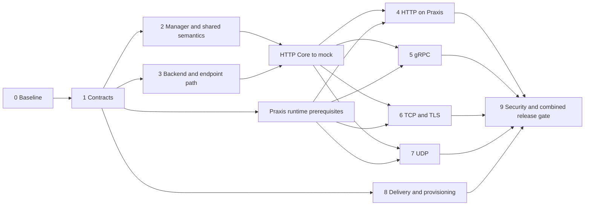

# Implementation phases and orchestration

Status: the first mock-backed HTTP Core control-plane slice is implemented. The remaining work is the real Praxis dataplane/connector and Core support for GRPCRoute, TLSRoute, TCPRoute and UDPRoute. Start at the [plan index](README.md).

## Current implementation snapshot

- `internal/config` defines typed, target/domain/owner-epoch-scoped listener, HTTP route table, cluster, EndpointSet and Secret-handle resources with deterministic revisions.
- `internal/delivery` defines the configurator/provisioner seams; `internal/delivery/mock` stores state, fences stale owner epochs, keeps AI/policy roots independent, and journals sanitized add/update/delete operations.
- `internal/gateway` compiles HTTPRoute attachment and HTTP/HTTPS listeners, authorization, supported HTTP Core path/header matching and filters, backend refs and EndpointSlice membership. Unsupported match/action rows are omitted without hiding invalid backend refs. TLS Secrets are parsed for valid type and matching cert/key; only identity, resourceVersion and validity enter compilation.
- `internal/controller` watches GatewayClass, Gateway, HTTPRoute, Namespace, Service, EndpointSlice, ReferenceGrant and metadata-only Secret events; it writes owned status and applies target-scoped changes to the mock. Mock `Programmed` status is explicitly simulated.
- `cmd/controller` starts the manager with secure metrics defaults, leader election, graceful shutdown and a process-scoped owner epoch. RBAC output is generated under `config/rbac`.
- An opt-in `file` delivery adapter (`internal/delivery/file` plus the pure `internal/praxis` renderer) lowers the HTTP/HTTPS slice into one Praxis YAML document per Gateway and writes it atomically. It reports delivered, never active, so `Programmed` stays `False/Pending`; mock remains the default adapter.

Repository-local gates currently pass: `go test ./...` (including envtest with Kubernetes 1.37.0 and Gateway API v1.6.3 CRDs), `go vet ./...`, a trimmed controller build, controller-gen RBAC generation and `go mod verify`. The file adapter adds renderer golden/rejection tests, adapter contract tests (delivery vs active, no write churn, fencing, crash repair, permissions) and race tests. No upstream conformance profile or real-Praxis traffic test was run. The cluster-wide Secret `get/list/watch` role is still a confidentiality-sensitive deployment risk; real ServiceAccount permission testing remains open.

## 1. Scope and completion criteria

Implement a Gateway API implementation for north/south Gateway traffic, covering the five requested profiles at the pinned Gateway API v1.6.3 release: `GATEWAY-HTTP`, `GATEWAY-GRPC`, `GATEWAY-TLS`, `GATEWAY-TCP`, `GATEWAY-UDP`. Core is a support level, not a resource list: GatewayClass, Gateway, listener behavior, ReferenceGrant and Kubernetes backends are also necessary. In v1.6.3 all five Route kinds are Standard-channel `gateway.networking.k8s.io/v1`. The [upstream research](../research/gateway-api-conformance.md) gives the exact source and 67-test combined Core inventory.

Completion means all applicable required Core tests pass against the actual controller and actual Praxis image, with an unmodified pinned upstream runner and no hidden exclusions; expected negative tests also pass. It additionally requires the endpoint/configuration independence, security, restart and failure gates in [testing and security](testing-and-security.md). Passing upstream conformance alone does not prove those project-specific requirements.

Exclude Extended features from the initial support claim and test selection. Do not schedule Gateway mesh profiles, BackendTLSPolicy, ListenerSet, custom backend kinds, policy inheritance, AI semantic routing, retries, mirroring, arbitrary extension filters or an xDS implementation merely because they exist upstream or in Praxis. A feature excluded from an Extended support claim may still need safe unsupported-field status handling. Where tagged Core tests and API support annotations disagree, record the discrepancy and resolve it against the pinned suite/spec rather than silently skipping the test.

## 2. Research findings that determine the schedule

| Finding | Consequence |
| --- | --- |
| Existing controller repo is empty apart from guidance and module declaration | Establish manager/tooling and contracts before distributing implementation work |
| Praxis configuration reload currently reparses the root and reconstructs pipelines | Independent EndpointSet runtime application is an upstream prerequisite, not just controller optimization |
| Top-level Praxis clusters primarily feed health/admin; inline LB clusters feed traffic | Rendering only the top-level cluster list cannot implement forwarding; configurator needs verified serving-state integration |
| Native HTTP route ordering differs from Gateway precedence | Compiler and runtime action/matcher gaps must be proven before HTTP conformance claims |
| Existing protocol enum has HTTP/TCP only | UDP profile requires Praxis transport work; a UDPRoute translator alone is insufficient |
| TLS passthrough SNI selection and named TCP load balancing are not proven composable | Implement/verify SNI-to-cluster forwarding and independent membership before TLS profile integration |
| TCP private destination protection lacks a suitably scoped Kubernetes endpoint trust path | Do not enable a blanket private-upstream bypass to make tests pass; add scoped trust and negative tests |
| Listener inventory/protocol/TLS-mode changes are startup-only; some changes are rejected | Provide managed target replacement or new runtime capabilities; Core includes listener modifications |
| Certificate content reload differs for single and multiple certificates | Test rotation under each selected deployment; do not claim all Secret updates are hot reloadable |
| AI and policy have independently referenced documents and their own lifecycles | Preserve independent root ownership; endpoint events cannot reload those documents or reset their state |

These are source-based assessments of the pinned snapshots, not test results. [Praxis evidence and detailed gaps](../research/praxis-configuration.md).

## 3. Phase 0 — freeze the implementation baseline

**Depends on:** this research. **Deliverables:** reviewed scope/compatibility matrix, concrete backlog and reproducible inputs.

- Pin Gateway API module, CRD bundle, conformance nested module, expected test inventory and upstream commit to v1.6.3. Record bundle SHA, image digests, target Kubernetes minor and toolchain in a machine-readable run manifest when implementing the harness.
- Keep Go 1.27.2 from this repo unless there is a demonstrated compatibility reason to change it. Add controller-runtime v0.25.2, controller-tools v0.23.0 as a Go tool, and aligned Kubernetes v0.37 dependencies during implementation. Choose envtest's exact 1.37 patch and a matching available kind node image; availability is a prerequisite to verify, not assumed from client versions. Define supported server minors from passing real-cluster runs.
- Read the mandatory skill references for each work item. Use pure controller-runtime/controller-gen; hand-write required deployment/bindings. No kubebuilder scaffolding or replacement copies of upstream APIs.
- Freeze the controller name and initial ownership model. Proposed first mode is managed isolated targets per Gateway; a sidecar alone is a delivery location and does not decide who provisions the target.
- Convert the source gap matrix into separate controller/Praxis/AI/policy work items with owners and linked acceptance evidence. Recheck source revisions before beginning, since this is a dated baseline.
- Select explicit Core-only features in the runner. Prevent status auto-discovery or `all-features` from expanding the requested scope. Keep the conformance module separate from production dependency resolution.

**Validation gate:** review the complete pinned Core inventory and required protocol behaviors, including UDP/TCP weighted backends and listener changes. Resolve version/module/image availability. No feature claim is advertised yet.

**Parallel work:** tooling baseline, detailed per-protocol gap proof, and the test-environment/exposure design can proceed independently. Do not parallelize edits to shared resource contracts until Phase 1 freezes them.

## 4. Phase 1 — freeze the resource and connector contracts

**Depends on:** Phase 0 ownership and scope. **Deliverables:** typed resource model, ownership/invalidation rules, connector/provisioner contracts and their tests.

- Implement only the shared contracts described in [architecture](architecture.md): stable target/resource keys, Cluster-to-EndpointSet references, separate secret material, independent AI/policy root slots, deterministic revisions, changes/deletions, active revision observations and structured diagnostics.
- Keep semantic compilation independent of Praxis YAML and xDS. Define capabilities as verified runtime facts; reject a lowering that cannot preserve required semantics instead of silently approximating it.
- Establish the Apply/Observe contract and target ensure/release contract. Include cancellation, retry/idempotency, NACK, dependency activation, target process epochs, leader fencing, stale receipt rejection and restart resynchronization.
- Build a stateful in-memory mock keyed by a synthetic target per Gateway. It stores independent target/root/resource state and records sanitized structured add/update/delete operations for listeners, routes, clusters and EndpointSets. Replays are idempotent; controlled NACK, disconnect and stale-receipt behavior is testable. A successful mock can return an explicit simulated-active receipt for status tests, but cannot establish real forwarding or conformance.
- Define independent update tests at the same time: replacing one EndpointSet changes no Cluster/listener/route/AI/policy revision; unrelated roots keep both content and compile invocation counts unchanged.
- Establish fail-closed revocation semantics and the ownership rule for deleting stale resources. Avoid persistent IR CRDs or a generalized configuration framework until a concrete need appears.

**Validation gate:** contract tests cover ordering, partial rejection, duplicate updates, reconnect, old ACKs and deletion/recreation; deterministic output under input permutation; positive controls prove suppressed updates were actually processed. A fake active receipt is distinct from a write/enqueue receipt. Security review confirms no key/tenant collision, no Secret content in diagnostics, and no stale authorized route retained after revocation.

**Parallel work:** after the contract is stable, the HTTP compiler, Kubernetes watch/status work, and mock adapter can proceed in parallel. Start GRPC/TLS/TCP/UDP route compiler slices after the HTTP mock milestone passes; runtime-gap research may continue earlier.

## 5. Phase 2 — controller foundation, attachment and status

**Depends on:** Phases 0–1. **Deliverables:** operable manager, correct shared Gateway semantics, dependency indexes and real API-server tests.

- Wire scheme/manager, controller selection, centralized indexes, cache readiness, leader election, context-aware shutdown and bounded reconcile work. Add authenticated TLS metrics and explicit RBAC/bindings from the mandatory skill. Configure one logging backend before startup.
- Watch GatewayClass, Gateway, the Route kinds in the current slice (HTTPRoute first), Services, EndpointSlices, Namespaces, ReferenceGrants and only authorized TLS Secrets needed for HTTPS listeners. Add other Route-kind watches with their later slices. Record reads/fields in a cache review table. Avoid global generation filtering and avoid cluster-wide Pod caching.
- Implement common attachment: controller ownership, normalized parent references, section/port intersection, allowedRoutes kind/namespace restrictions, hostname intersection, listener protocol compatibility, conflict handling and deterministic route collection. Re-evaluate both removal and addition on changes.
- Implement owned GatewayClass/Gateway/listener/Route-parent status using upstream condition names/reasons, generations, supportedKinds and attachedRoutes counts. Preserve other writers and other controllers' parent entries. Separate validation outcomes from observed programming outcomes.
- Implement lookup/authorization of namespaced backends and certificates, including future referent creation and ReferenceGrant revocation. Keep invalid references represented for prescribed failure actions and diagnostics.
- Add finalizers only where target cleanup needs them; obey namespace ownership rules. Ordinary API objects may be absent/deleting without error loops.

**Tests:** pure attachment/authorization tables; envtest with upstream CRDs for status conflicts, generation correctness, list schemas, watches and indexes; API-reader impersonation and kind tests for real RBAC. Assert zero panic metrics and no writes on unchanged reconciliation.

**Validation gate:** change Namespace labels, grants, parent refs and Secret data while the manager runs and observe exactly the expected consumers/status. An unowned GatewayClass receives no writes. Status must not become Programmed from enqueue or write acceptance alone; mock tests may set it only after an explicit simulated-active receipt, which is not production evidence.

**Parallel work:** manager/operations and pure attachment logic can start together against frozen contracts. Assign one owner for status aggregation and one for index registration to avoid conflicting writers/registrations.

## 6. Phase 3 — backend resolution and the endpoint update path

**Depends on:** Phase 1; integrates with Phase 2. **Deliverables:** shared backend resolver and independently delivered EndpointSets.

- Resolve Service backend ports by the Gateway API contract; translate Service ports to EndpointSlice resolved target ports. Support multiple slices, membership readiness, deletion, deduplication and supported IP families. Core's Service-type test requires headless and selectorless/manual-EndpointSlice cases as well. Explicitly handle no endpoints, missing/invalid ports, incompatible transport, zero weights and Service UID replacement; do not require every slice to have a Kubernetes controller ownerReference.
- Give each supported Service-port-protocol backend a stable identity. Keep endpoint membership out of cluster/route hashes. Index reverse users by normalized backend reference and Service-port keys.
- Coalesce EndpointSlice updates per backend without a whole-Gateway compile. Handle tombstones and old/new Service labels; a backend shared by several Gateways updates their target-local EndpointSets only.
- Add strict destination provenance and address validation for Pod/Service networks. Reconcile this with Praxis SSRF protections through scoped trust metadata accepted only from the controller/adapter. Do not disable protection globally.
- In Praxis, implement or prove an independent backend membership handle/update mechanism that does not reconstruct HTTP/TCP filters, AI routing snapshots or policy executors. This upstream work is required even if file fragments are selected.

**Tests:** resolver unit tables, envtest watch/update tests and actual-Praxis backend churn tests. Replace Pods on a real cluster so the Kubernetes EndpointSlice controller produces changes. Assert eventual removal/new endpoint traffic, exact changed resource keys, zero unrelated compilations/serializations, unchanged Deployment template and unchanged runtime filter identities/state.

**Validation gate:** the user's example passes end to end under success, burst updates and reconnect. Empty ready membership removes stale endpoints; failure cannot silently reintroduce an old membership. A whole-YAML rebuild fails this phase even if traffic eventually reaches the new Pod.

**Parallel work:** controller endpoint resolver and Praxis runtime membership work proceed together using the Phase 1 contract; adapter work can proceed against recorded fixtures. Integration is a blocking gate before endpoint support is considered complete.

### First implementation milestone — HTTP Core control plane through the mock

This first end-to-end controller milestone spans Phases 1–3 and precedes the real-Praxis HTTP data-plane phase below. It implements the pinned `GATEWAY-HTTP` Core control-plane behavior: GatewayClass selection, HTTP/HTTPS listener handling including authorized Secret references, HTTPRoute attachment and status, Core route compilation, Service backend resolution, and EndpointSlice-driven membership. It applies typed resources to the mock and serves no requests.

Use one synthetic mock target per Gateway. The controller emits resource-level changes for listeners, routes, clusters and endpoints; it does not produce a whole Praxis configuration. The mock keeps Praxis, AI and policy roots separate, while Gateway reconciliation changes only Praxis. Backend membership comes from Services and EndpointSlices, including required headless and selectorless/manual-slice cases; no cluster-wide Pod watch is added.

**Validation gate:** pure tests cover the pinned Core HTTP semantics and deterministic resource changes. Ginkgo/Gomega envtest with upstream Gateway API CRDs exercises reconciliation, status, dependencies and watches. Mock contract tests assert add/update/delete journaling, replay idempotency, failure/retry behavior, correct Programmed transitions after explicit simulated-active receipts, and that an EndpointSlice-only change changes only the affected EndpointSet. Positive controls prove the event was consumed while listener, route, cluster, AI and policy revisions stay unchanged. Required build/test, code-generation-diff, vet/static-analysis and lint gates pass.

Tests in the implemented slice cover allowedRoutes selector/kind decisions, positive and negative ReferenceGrant cases, rejection of unauthorized backends, HTTPS Secret authorization/type/keypair validation, EndpointSlice condition filtering, and checks that certificate/key bytes do not enter compiler resources, Gateway status or mock change payloads/logs. This does not close the deployment security gate: the generated ClusterRole has cluster-wide Secret `get/list/watch`, and real ServiceAccount permission tests, metrics authorization integration tests, destination-trust validation and actual certificate loading/rotation remain open.

This gate establishes a mock-backed controller milestone only. It does not pass or claim the upstream GATEWAY-HTTP profile, because no requests are served. Full conformance requires the actual controller and Praxis dataplane, and final completion still requires every applicable Core test for HTTP, GRPC, TLS, TCP and UDP without hidden exclusions.

## 7. Phase 4 — HTTPRoute and HTTPS termination on actual Praxis

**Depends on:** the mock-backed HTTP milestone, Phase 2 attachment and Phase 3 backends. **Deliverables:** actual Praxis forwarding and runtime behavior for `GATEWAY-HTTP` Core.

- Implement the exact Core path matching, segment boundaries, hostname intersection/wildcard behavior, header matches and route precedence/tie-breaks from the pinned types and tests. Preserve request path/authority semantics where required.
- Implement Core request header modification and redirects, all required filter ordering/validation, Service forwarding and invalid/missing backend failure behavior. Classify optional fields by the pinned release; do not copy historical assumptions about which matches/filters are Core.
- Implement HTTP/HTTPS listeners, correct certificate authorization/material handling and required listener/route status. Ensure the selected Praxis matcher/action can encode compiled behavior; add upstream runtime support where it cannot.
- Exercise listener additions/removals and certificate changes through the actual provisioner/connector. Use real traffic assertions and upstream response details, not only YAML golden files.

**Tests:** pure compiler expected-action fixtures; Praxis matcher/filter contract tests; envtest status/update tests; real Praxis traffic tests; complete HTTP and shared Gateway Core subset. Keep optional Extended tests out of the required set.

**Validation gate:** the real GATEWAY-HTTP Core profile's required tests pass without omissions, including traffic, negative/reference/status and listener reconfiguration tests. Endpoint churn continues to satisfy Phase 3's independence assertions.

**Parallel work:** HTTP compiler, matcher/action fixes and TLS/provisioner work are separate owners; integration needs all three. Freeze common route precedence helpers before gRPC adopts them.

## 8. Phase 5 — GRPCRoute Core

**Depends on:** shared semantics and backends; shares HTTP infrastructure. **Deliverables:** `GATEWAY-GRPC` Core behavior.

- Match required service/method/hostname/header semantics and deterministic precedence. Validate overlapping HTTPRoute/GRPCRoute attachment according to upstream rules rather than relying on filter-chain order.
- Configure real HTTP/2 downstream and upstream transports, including cleartext upstream behavior required by the selected Service protocol. Verify gRPC status/trailers and failure responses; HTTP/1 forwarding of a gRPC-shaped path is not sufficient.
- Implement only required gRPC filters/backend behavior and correct unresolved-reference/unsupported-value status. Record any upstream h2 client/connection-pool changes as Praxis prerequisites.

**Tests:** compiler precedence/error fixtures, real HTTP/2/gRPC traffic and trailers, shared listener tests and the full Core gRPC profile. Long-lived streams and endpoint replacement are project regression tests even when not separately certified by the profile.

**Validation gate:** all required gRPC tests pass against the selected build; shared HTTP Core remains green.

**Parallel work:** can run alongside HTTP implementation after shared contracts, but integration must coordinate transport options and the listener route-table merger.

## 9. Phase 6 — TCPRoute and TLSRoute Core

**Depends on:** shared semantics and backends; requires TCP/SNI runtime and trust capabilities. **Deliverables:** both transport profiles.

- TCPRoute: listener binding, Service forwarding, weighted backends, parent section/port combinations, deterministic conflicts and safe missing/empty backend behavior.
- TLSRoute: TLS passthrough with SNI/hostname intersection and weighted named-cluster forwarding. Preserve end-to-end backend TLS; do not terminate it or load private keys merely to select a route. Test fragmented ClientHello, bounded peeking, timeouts and byte preservation.
- Make SNI routing compose with stable cluster references/independent endpoints. Verify TCP LB strategy and connection behavior, including changes to cluster selection that are currently captured at startup.
- Add a scoped Kubernetes trusted-endpoint path in Praxis; include negative SSRF tests and disallowed cross-namespace references.
- Use lifecycle/provisioner updates where native listener binding cannot be changed live; retain appropriate connection draining without allowing removed listeners to remain publicly accessible.

**Tests:** pure transport compiler/status tables, echo and TLS backends with distinct identities, weighted distribution as the upstream runner checks it, security/refusal tests, listener changes and both complete Core profiles.

**Validation gate:** both profiles pass and endpoint-only changes update new connections without rebuilding unrelated filters or restarting the target. Verify HTTP/gRPC regression suites for shared transport changes.

**Parallel work:** TCP and TLS translators can run independently; assign a single owner for shared TCP target selection/LB and another for SNI inspection. Both depend on the same scoped trust work.

## 10. Phase 7 — UDPRoute Core

**Depends on:** shared contracts/backends; native UDP support is a separate Praxis prerequisite. **Deliverables:** `GATEWAY-UDP` Core behavior.

- Add/verify a UDP listener/datagram transport in Praxis before claiming controller support. Define datagram routing, weighted backend selection, reply association, bounded flow state, idle eviction, memory limits and behavior when endpoints change.
- Implement UDPRoute listener/parent attachment, Service protocol validation, weighted backend references, conflicts and required missing backend/refusal/drop behavior.
- Provision UDP-capable Service exposure and test return paths. TCP reachability checks and HTTP readiness do not prove that UDP works.

**Tests:** UDP round-trip, multiple clients, distinct backend identities, weighted traffic, no-ready-endpoint behavior, flow expiry, backend removal, payload boundaries, resource bounds and Core UDP profile.

**Validation gate:** complete UDP Core profile with actual Praxis transport, plus abuse/resource-limit tests and no regression in the other profiles.

**Parallel work:** start native UDP runtime development after Phase 1 while HTTP/gRPC/TCP/TLS proceed. Controller translator work can use fixtures early but cannot close its gate before native runtime integration.

## 11. Phase 8 — one production delivery adapter and target lifecycle

**Depends on:** Phase 1; work overlaps Phases 2–7. **Deliverables:** one selected real connector, managed lifecycle/addresses and the observation path.

- The maintainer selected the file option first (Option A). It is implemented as an opt-in static-target adapter and proves delivery only: it writes atomically, fences owner epochs and survives restart, but it does not observe Praxis parsing, reload or serving. A future authenticated control-plane/data-plane protocol (Option B) stays behind the same `delivery.Configurator` seam and must add real ACK/NACK and active-revision observation; do not implement it pre-emptively or commit to xDS.
- The file adapter cannot satisfy the independent-endpoint-update gate because Praxis rebuilds pipelines on whole-file reload. That requirement remains open for Option B or Praxis runtime work.
- For files, prove atomic publication, private secret material, directory/symlink watching, startup baseline correctness, rejection handling and per-resource runtime updates. For network delivery, prove identity/authz, bounded message sizes, ACK/NACK, version tracking and stale-writer fencing.
- Implement target ensure/release, safe replacement for bootstrap changes, Service exposure, cleanup/finalizers and reachable Gateway status addresses. Keep Deployment template changes tied only to bootstrap/image/lifecycle changes.
- Prove multi-target rollouts: report which serving instances have the desired configuration; quarantine outdated unsafe instances before claiming the new listener state. A single arbitrary Pod ACK is insufficient.

**Tests:** run every adapter contract against the real adapter and actual Praxis, crash during publication/activation, connector disconnect, controller/target restart, leader failover, removed Gateway cleanup, listener modify test, certificate rotation and independent-root changes.

**Validation gate:** all selected deployment-mode behavior passes on a real cluster, including the Phase 3 endpoint requirement. Earlier protocol milestones may be developed with fakes, but final Core claims require this phase.

## 12. Phase 9 — security, scale and release evidence

**Depends on:** all target profiles and the real adapter. **Deliverables:** release candidate, threat-model findings resolved, repeatable reports and operations documentation.

- Execute the complete [testing/security matrix](testing-and-security.md), including RBAC under real ServiceAccounts, tenant isolation, grant/Secret revocation, stale writer/ACK behavior, malformed input and resource bounds.
- Measure endpoint convergence, affected-resource count, memory, queue depth, API writes and reconnect recovery under documented scale and burst conditions. Define measured operational budgets; do not invent production capacity from unit-test timings.
- Run the pinned combined Core suite without exclusions, plus per-profile runs when useful for diagnosis. Preserve release image digests, CRD/suite commits, selected features, raw test output, reports, status snapshots and sanitized failure artifacts.
- Advertise only verified capabilities in GatewayClass/listener status. Write installation, permissions, supported versions, unsupported features, target lifecycle/restart behavior, connector recovery, upgrades and debugging guides.
- Submit upstream conformance results using the upstream report requirements when releasing. Submission or certification is a separate external action from producing local evidence.

**Validation gate:** all five Core profiles pass, no required tests skipped, all project-specific incremental/security gates pass, no unresolved blocking vulnerability or incorrect capability claim. Any unimplemented profile remains explicitly incomplete; passing HTTP alone does not complete this project.

## 13. Dependency graph and parallel lanes

The numbering groups deliverables, not a requirement to finish every earlier protocol before starting the next. A practical four-owner schedule after Phase 1 is:

| Lane | Initial ownership | Later ownership | Shared integration restrictions |
| --- | --- | --- | --- |
| A | Manager, watches/indexes, attachment/status | Operations, RBAC and failure recovery | Own status aggregation and index registration |
| B | Backend resolver and endpoint invalidation | Selected delivery adapter and provisioner | Coordinate runtime membership/ACK schema with D |
| C | HTTP then gRPC compilation and Core tests | Cross-protocol precedence and conformance harness | Own shared HTTP route-table schema/merging |
| D | Praxis runtime membership and matcher gaps | TCP/TLS then UDP runtime/translation | Break into additional owners only with isolated runtime seams |

Security review and test fixtures accompany each lane, with independent review of authorization/status/application logic before integration. If more people are available, split HTTP/gRPC, TCP/TLS and UDP after their shared contracts are stable; do not split by Route kind while duplicating backend and attachment logic.

The first coding wave used the parent as integrator plus three non-overlapping `gpt-6-luna` agents at `xhigh`, after the shared resource/configurator contract was frozen:

| Owner | Initial package scope | Responsibilities |
| --- | --- | --- |
| Parent integrator | Shared `internal/config` and `internal/delivery` contracts; manager wiring, RBAC, integration/security gates | Freeze resource/receipt types first, own shared files, integrate and review all changes |
| Agent A | `internal/controller` | GatewayClass/Gateway/HTTPRoute watches, indexes, attachment and status |
| Agent B | `internal/gateway` | Pure HTTP Core compiler and Service/EndpointSlice backend resolution |
| Agent C | `internal/delivery/mock` | Synthetic per-Gateway target state, structured operation journal, simulated receipts and fault injection |

That initial wave has been integrated. The parent owned shared types, manager wiring and acceptance tests; package agents owned controller, HTTP compiler and mock changes. Controller code followed the mandatory `k8s-controller-runtime` skill and received an independent Gateway API semantics review. Later protocol slices can parallelize only behind the same attachment/backend contracts and with one owner for shared status and route merging. The initial mock-backed milestone had no production connector; the file adapter was added afterwards as a separate, opt-in delivery-only slice. No Praxis runtime implementation is part of either milestone.

For every future work packet record: affected repositories, pinned inputs, owner, dependent contract revision, exact touched packages, behavior/negative cases, tests and passing evidence. Freeze shared types and assign a single integrator for changes to them. Require integrated reruns after merging concurrent work; isolated lane success does not establish combined behavior.

## 14. Decisions and risks to close

| Decision/risk | Default direction | Must close before |
| --- | --- | --- |
| Concrete production connector | File adapter selected for Option A (delivery only, static target). Network/control-plane transport remains Option B. | Phase 8 completion and any conformance claim |
| Managed versus existing targets | Managed isolated Gateway targets for first deployment | Phase 0 ownership freeze |
| Native incremental runtime resource interface | Endpoint-set replacement with stable runtime handles; no full pipeline rebuild | Phase 3 completion |
| HTTP matcher/actions and gRPC transport gaps | Prove exact behavior; add Praxis capabilities where needed | Corresponding Core profile gate |
| TLS SNI-to-cluster and scoped TCP trust | Upstream Praxis work required | Phase 6 completion |
| UDP implementation | Upstream native transport required | Phase 7 completion |
| Listener rollout/exposure/drain rules | Managed replacement with observed active bootstrap | Shared Gateway Core gate |
| AI/policy root Kubernetes representation | Defer custom APIs; preserve separate producer/resource contracts | First AI/policy feature, not basic Gateway bootstrap |
| Operational limits and revocation budget | Select from measured workload and security requirements | Production release |
| Exact Kubernetes patch/kind image and support range | Pin available artifacts and verify actual clusters | Harness bootstrap and release matrix |
| Upstream annotation/test discrepancies | Keep explicit ledger; required tagged tests are the minimum gate | Baseline freeze and every API upgrade |

No connector decision removes the need to implement the protocol and runtime prerequisites. No rejected optional feature should silently broaden the initial support claim. New requested Extended or implementation-specific features need their own scoped plan after Core is proven.
